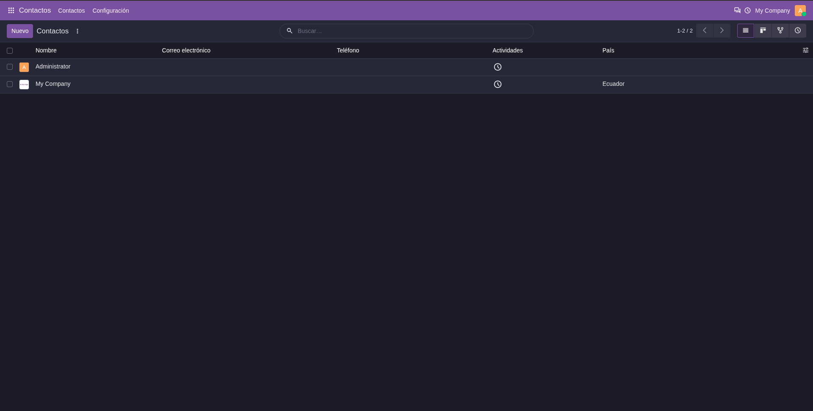
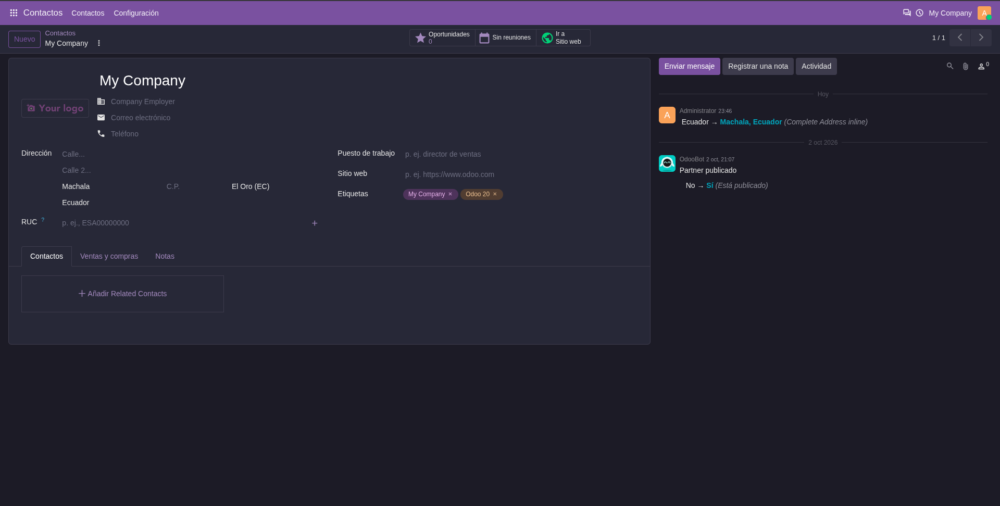
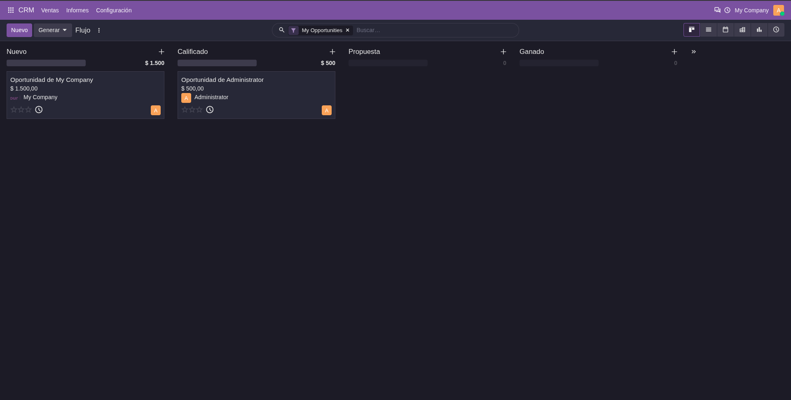
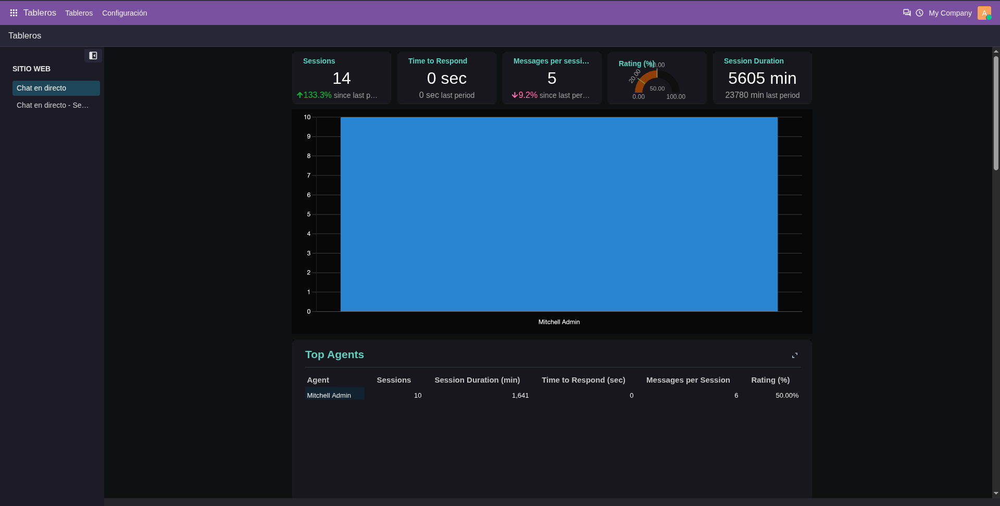

Per-user dark mode for the Odoo Community backend.

- The preference is stored on the user, not in the browser, so users sharing
  a browser keep their own scheme. The `color_scheme` cookie is kept in sync
  from the server and cleared on logout.
- Uses Odoo's native dark bundles (`web.assets_web_dark`,
  `web.assets_backend_lazy_dark`), so the core `*.dark.scss` files (mail,
  calendar, html editor, sale...) apply as they do in Enterprise.
- Real dark palette, aligned with Odoo Enterprise's dark mode, plus
  component fixes (buttons, statusbar, kanban, dropdowns, alerts, settings,
  spreadsheet dashboards...). It is not a CSS color inversion.

Community only: Enterprise ships its own dark mode, so this module cannot be
installed together with `web_enterprise`.

**List view**

**Form view with chatter**

**Kanban view**

**Spreadsheet dashboard**

