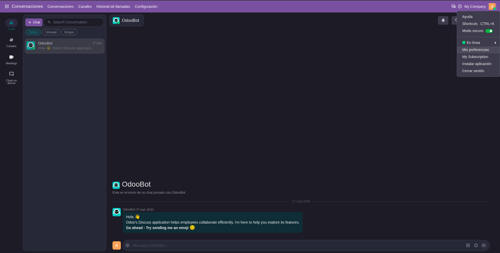
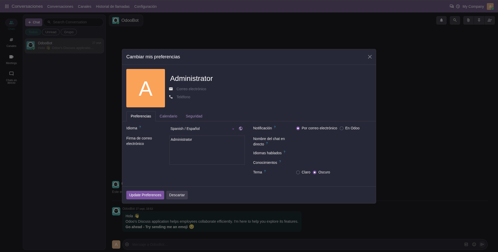

Each user can switch the scheme in two ways:

- **User menu** (avatar, top right): toggle **Dark Mode**. The page reloads
  with the new scheme.

  

- **My Profile / Preferences**: set **Color Scheme** to *Light* or *Dark*,
  save, and reload the page.

  

Administrators can also set it for any internal user from *Settings > Users*.
